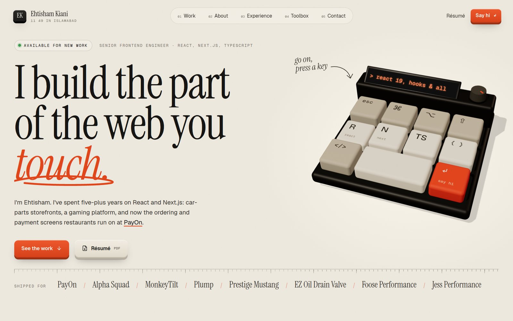
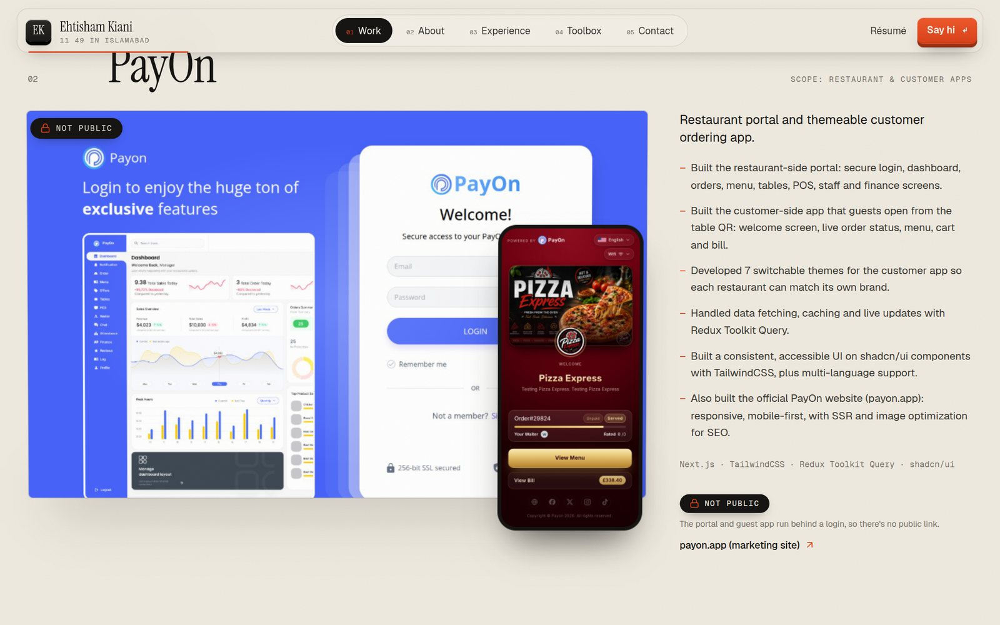
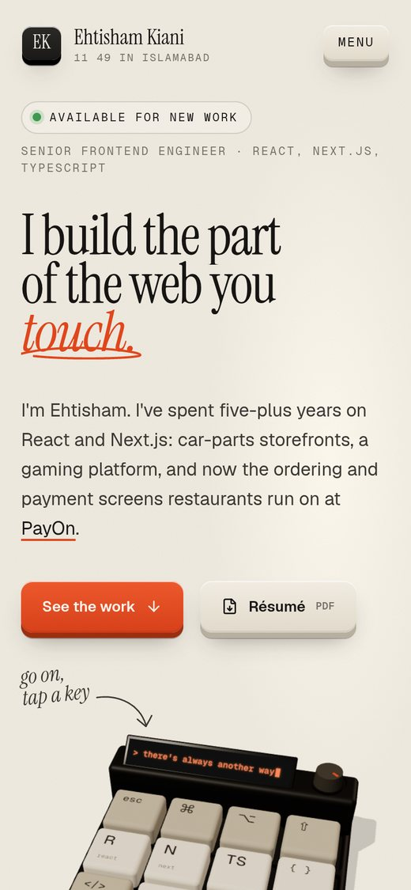
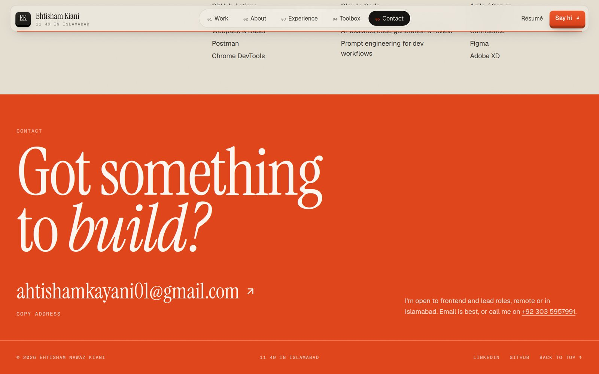

<div align="center">

# Ehtisham Nawaz Kiani — Portfolio

**Senior Frontend Engineer · React · Next.js · TypeScript**

A personal portfolio with a pressable 3D macropad in the hero, built with Next.js 16, React Three Fiber and Tailwind CSS v4.

[**Live site →**](https://ehtisham-portfolio-eta.vercel.app) &nbsp;·&nbsp;
[LinkedIn](https://www.linkedin.com/in/ehtisham-nawaz-kiyani-704a98173/) &nbsp;·&nbsp;
[Download CV](https://ehtisham-portfolio-eta.vercel.app/api/cv)

<br />



</div>

<br />

## What's inside

**A keyboard you can actually press.** The hero is a small mechanical macropad rendered in three.js. It isn't a video or a static image.

- Keys go down under your cursor. They also go down when you press the same key on your **real keyboard**: `R`, `N`, `T`, `Esc`, `Shift`, `Alt`, `⌘`, `Enter`…
- A tiny OLED screen types out a line for each key, and the aluminium knob turns a notch with every press.
- The orange `↵ say hi` key scrolls to the contact section.
- When it's idle, a key taps by itself now and then, as if someone's typing.

**Project screenshots with depth.** Each project screenshot is a CSS 3D slab. It tips back as it scrolls into view, flattens in the middle of the screen, and leans toward the cursor with a soft glare. Private projects carry a clear **Not public / Under NDA** badge instead of a missing link.

**A one-page CV generated on request.** `/api/cv` renders an A4 PDF with `@react-pdf/renderer`, so the downloadable CV always matches the site.

**Small touches**
- Keycap-style buttons that press into their own shadow.
- A floating nav with a highlight that follows the section you're reading, plus a reading-progress line.
- Live Islamabad time with a ticking colon.
- A hand-drawn scribble under *touch.*
- A paper-grain background, done in CSS with no image request.

<table>
  <tr>
    <td width="72%"></td>
    <td width="28%"></td>
  </tr>
</table>

## Tech stack

| Area | Tools |
| --- | --- |
| Framework | [Next.js 16](https://nextjs.org) (App Router, Turbopack), React 19, TypeScript |
| 3D | [three.js](https://threejs.org), [@react-three/fiber](https://r3f.docs.pmnd.rs), [@react-three/drei](https://drei.docs.pmnd.rs) |
| Styling | Tailwind CSS v4, custom design tokens (paper / ink / signal) |
| Motion | Framer Motion (scroll-linked transforms, layout animations, SVG path drawing) |
| Type | Instrument Serif, Geist, Geist Mono via `next/font` |
| PDF | `@react-pdf/renderer` in a route handler |
| Hosting | Vercel |

### Performance notes

- **three.js loads only in the browser, after the page.** It comes in through `next/dynamic` with `ssr: false`, so it never blocks the first paint.
- **The 3D scene pauses off-screen.** An `IntersectionObserver` switches the R3F `frameloop` to `"never"` once the hero scrolls away.
- **No per-frame React updates.** Key presses, cursor tilt and screen updates live in refs and `useFrame`, not React state.
- **Reduced motion is respected.** With `prefers-reduced-motion` on, the idle animation, ghost typing and scroll tilt are turned off.
- **The pad scales to its box.** It reads the canvas's aspect ratio, so it isn't cropped on narrow columns or phones.

## Getting started

Requires **Node.js 20+** and **npm**. The repo uses `package-lock.json`; don't add another lockfile, or Vercel will pick the wrong package manager.

```bash
git clone https://github.com/Ahtishamkayani01/Ehtisham-portfolio.git
cd Ehtisham-portfolio
npm install
npm run dev        # http://localhost:3000
```

```bash
npm run build      # production build
npm run start      # serve the production build
```

## Project structure

```
app/
  layout.tsx            fonts, metadata, theme colour
  page.tsx              section order
  globals.css           design tokens, keycap buttons, paper grain
  api/cv/route.tsx      one-page PDF CV (GET /api/cv)
components/
  three/macropad.tsx    the 3D macropad: keys, OLED, knob, lighting
  hero.tsx              headline, scribble, keycap CTAs, "Shipped for"
  navigation.tsx        floating nav, active-section pill, local time
  projects.tsx          3D screenshot slabs, Not-public badges
  about.tsx  experience.tsx  skills.tsx  contact.tsx  footer.tsx
  reveal.tsx            fade-in-on-scroll wrapper
lib/
  projects.ts           all project content (edit copy here)
public/images/projects  project screenshots
docs/                   README screenshots
```

## Editing content

| To change… | Edit |
| --- | --- |
| Projects (text, stack, links, private flags) | `lib/projects.ts`. Leave out `url` to show the **Not public** badge; set `nda: true` for **Under NDA**; use `privateNote` for the reason line. |
| Work history | `components/experience.tsx` |
| Skills / toolbox | `components/skills.tsx` |
| Downloadable CV | `app/api/cv/route.tsx`. Keep it to one page: check `/api/cv` after edits. |
| Macropad key legends & screen messages | `KEYS` and `MESSAGES` in `components/three/macropad.tsx` |
| Colours | CSS variables at the top of `app/globals.css` |

## Contact



Open to frontend and lead roles, remote or in Islamabad. Reach me at **ahtishamkayani01@gmail.com** or on [LinkedIn](https://www.linkedin.com/in/ehtisham-nawaz-kiyani-704a98173/).

---

<sub>Designed and built by Ehtisham Nawaz Kiani. Project screenshots belong to their respective clients and are shown as portfolio work.</sub>
